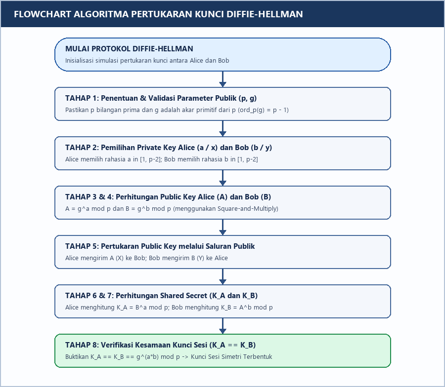
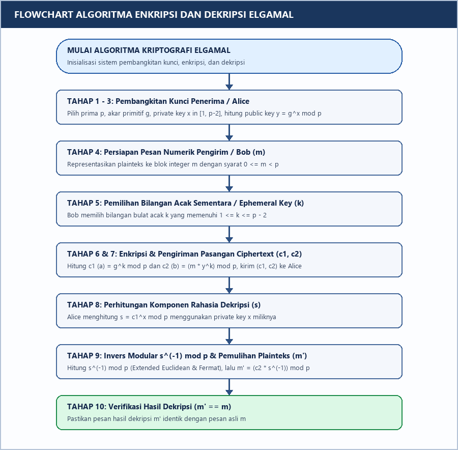
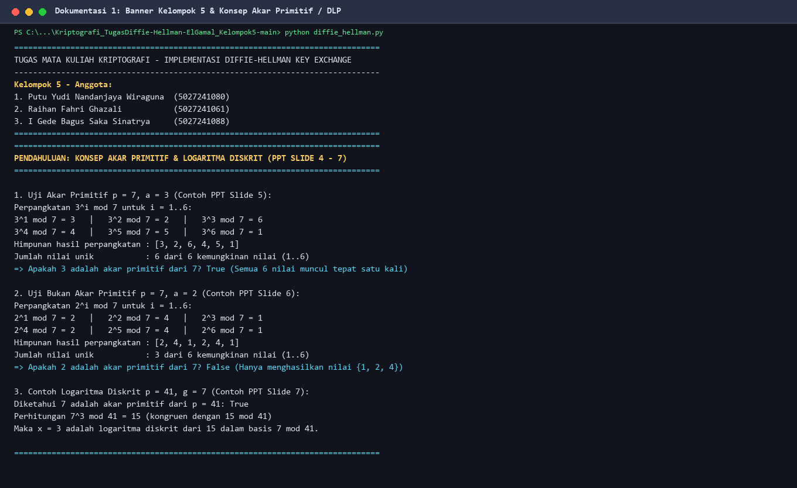
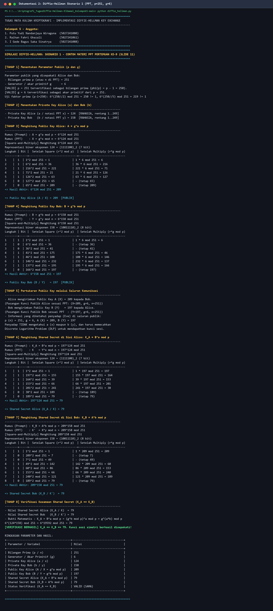
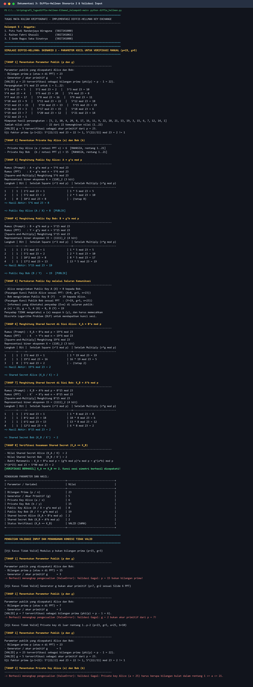
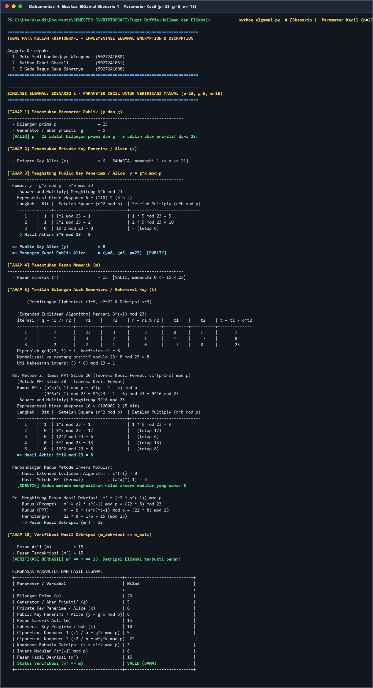
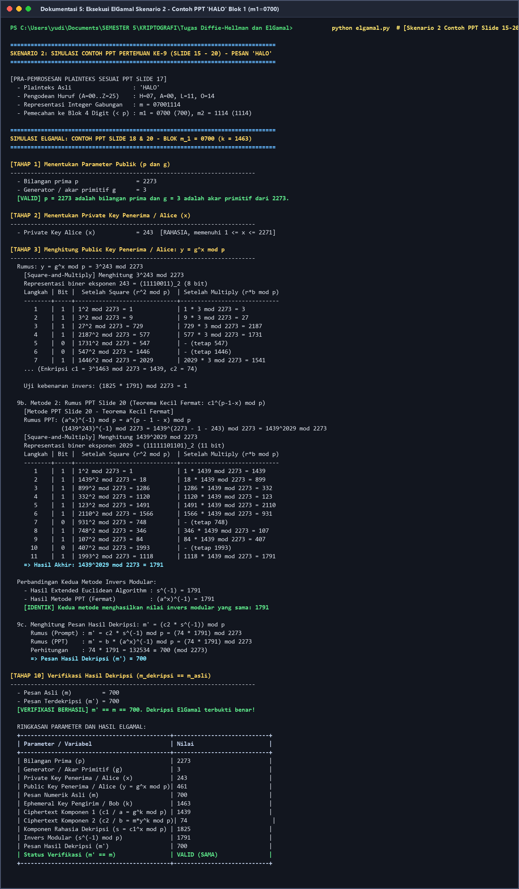
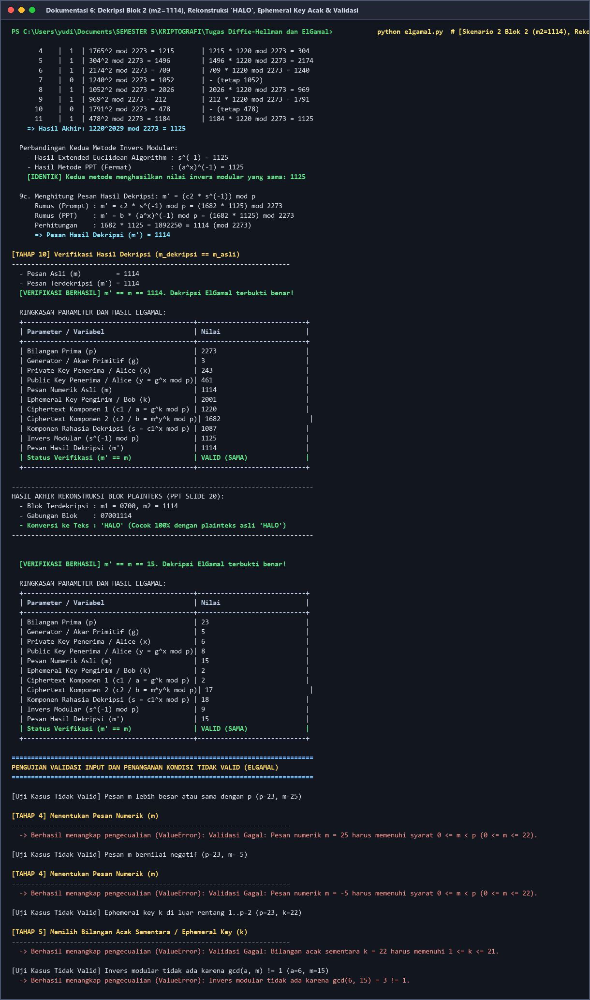

# Tugas Kriptografi: Implementasi Diffie–Hellman Key Exchange dan ElGamal Encryption

<div align="center">

**Mata Kuliah Kriptografi (Semester 5) – Pertemuan ke-9**  
**Program Studi Sarjana Teknologi Informasi – Departemen Teknologi Informasi**  
**Fakultas Teknologi Elektro dan Informatika Cerdas (FTEIC)**  
**Institut Teknologi Sepuluh Nopember (ITS) Surabaya**

</div>

---

## Identitas Anggota Kelompok

**Kelompok 5**

Kelompok 5: Putu Yudi Nandanjaya Wiraguna, Raihan Fahri Ghazali, I Gede Bagus Saka Sinatrya

| No | Nama Lengkap Mahasiswa | NRP |
| :-: | :--- | :---: |
| 1 | **Putu Yudi Nandanjaya Wiraguna** | `5027241080` |
| 2 | **Raihan Fahri Ghazali** | `5027241061` |
| 3 | **I Gede Bagus Saka Sinatrya** | `5027241088` |

---

## Deskripsi Proyek

Repositori/proyek ini merupakan implementasi dari dasar (*from scratch*) untuk dua algoritma kriptografi kunci publik fundamental, yaitu **Diffie–Hellman Key Exchange** dan **ElGamal Encryption**, menggunakan **Python standar tanpa library atau framework kriptografi eksternal** (`cryptography`, `PyCryptodome`, `sympy`, maupun fungsi perpangkatan tiga argumen `pow(a, b, m)`).

Seluruh konsep matematika, rumus, notasi simbol, tahapan algoritma, hingga studi kasus pengujian merujuk secara langsung pada materi perkuliahan **Pertemuan ke-9 (`Pertemuan ke-9_El Gamal dan Diffie-Hellman.pptx`)** serta literatur rujukan utama (Rinaldi Munir, 2019; Jean-Philippe Aumasson, 2017).

### Keunggulan & Fitur Utama
1. **100% Manual & Transparan**:
   - Uji keprimaan bilangan bulat (`is_prime`) dan ekstraksi faktor prima (`prime_factors`).
   - Verifikasi akar primitif (`is_primitive_root`) beserta pencetakan siklus perpangkatan $g^1, g^2, \dots, g^{p-1} \bmod p$ sesuai Slide 4–6 PPT.
   - Perpangkatan modular manual menggunakan algoritma **Square-and-Multiply (*Binary Exponentiation*)** (`modular_exponentiation`) yang mencetak tabel penelusuran bit biner langkah demi langkah.
   - Perhitungan invers modular manual pada dekripsi ElGamal menggunakan **dua metode sekaligus**:
     - **Extended Euclidean Algorithm** (`extended_euclidean_inverse`) lengkap dengan tabel iterasi kuosien, sisa, dan koefisien Bézout.
     - **Teorema Kecil Fermat** (`fermat_inverse_power`) menggunakan rumus $(a^x)^{-1} \equiv a^{p-1-x} \pmod p$ sesuai Slide 19–20 PPT, serta membuktikan bahwa kedua metode menghasilkan nilai invers yang **identik**.
2. **Kompatibilitas Notasi Ganda (Prompt Tugas & Slide PPT)**:
   - Menampilkan simbol spesifikasi tugas ($p, g, a, b, A, B, K_A, K_B$ dan $c_1, c_2, s, s^{-1}$) berdampingan dengan simbol pada slide PPT ($n, g, x, y, X, Y, K, K'$ dan $a, b, (a^x)^{-1}$).
3. **Validasi Input & Penanganan Kondisi Tidak Valid**:
   - Dilengkapi validasi keprimaan modulus $p$, syarat akar primitif $g$, syarat rentang kunci privat $1 \le x \le p-2$, syarat rentang pesan $0 \le m < p$, syarat *ephemeral key* $1 \le k \le p-2$, dan eksistensi invers modular ($\gcd(s, p) = 1$).

---

## Struktur File Proyek

```text
Kriptografi_TugasDiffie-Hellman-ElGamal_Kelompok5-main/
├── diffie_hellman.py                                    # Program utama Diffie-Hellman Key Exchange
├── elgamal.py                                           # Program utama ElGamal Encryption & Decryption
├── Laporan_Tugas_Diffie_Hellman_dan_ElGamal.docx        # Laporan resmi project
├── README.md                                            # Dokumentasi utama proyek, panduan, dan hasil pengujian
└── dokumentasi/                                         # Folder berisi diagram flowchart & screenshot eksekusi terminal
    ├── flowchart_diffie_hellman.png                     # Diagram alir visual Diffie-Hellman Key Exchange
    ├── flowchart_elgamal.png                            # Diagram alir visual ElGamal Encryption & Decryption
    ├── 01_konsep_akar_primitif_dan_dlp.png              # Screenshot uji akar primitif & logaritma diskrit (PPT Slide 4-7)
    ├── 02_diffie_hellman_ppt_s1.png                     # Screenshot Diffie-Hellman Skenario 1 (PPT Slide 11: p=251, g=6)
    ├── 03_diffie_hellman_kecil_s2_dan_validasi.png      # Screenshot Diffie-Hellman Skenario 2 (p=23, g=5) & validasi input
    ├── 04_elgamal_kecil_s1.png                          # Screenshot ElGamal Skenario 1 (p=23, g=5, m=15, k=10)
    ├── 05_elgamal_ppt_halo_blok1.png                    # Screenshot ElGamal Skenario 2 PPT 'HALO' Blok 1 (m1=0700)
    └── 06_elgamal_ppt_halo_blok2_dan_validasi.png       # Screenshot ElGamal Skenario 2 Blok 2 (m2=1114) & rekonstruksi 'HALO'
```

---

## Persyaratan Sistem (*Requirements*)

- **Bahasa Pemrograman**: Python `3.7` atau lebih baru (diuji pada Python `3.13`).
- **Dependensi Eksternal**: **Tidak ada** untuk menjalankan `diffie_hellman.py` dan `elgamal.py` (murni menggunakan pustaka bawaan Python standar).
- **Sistem Operasi**: Windows, Linux, atau macOS.

---

## Cara Menjalankan Program

Buka terminal (*PowerShell* atau *Command Prompt*) pada direktori proyek ini, lalu jalankan perintah berikut:

### 1. Menjalankan Simulasi Diffie–Hellman Key Exchange
```bash
python diffie_hellman.py
```
Secara otomatis menjalankan:
1. **Konsep Dasar PPT Slide 4–7**: Pembuktian $a=3$ akar primitif dari $p=7$, $a=2$ bukan akar primitif dari $p=7$, dan logaritma diskrit $7^3 \equiv 15 \pmod{41}$.
2. **Skenario 1 (Contoh PPT Slide 11)**: $p (n) = 251, g = 6, a (x) = 124, b (y) = 158 \implies A = 209, B = 197, K_A = K_B = 79$.
3. **Skenario 2 (Parameter Kecil untuk Verifikasi Manual)**: $p = 23, g = 5, a = 6, b = 15 \implies A = 8, B = 19, K_A = K_B = 2$.
4. **Uji Validasi Input Tidak Valid**: Menangkap `ValueError` untuk modulus bukan prima, generator bukan akar primitif, dan kunci privat di luar rentang.

Untuk menjalankan **mode input interaktif** (memasukkan parameter sendiri saat demonstrasi di kelas):
```bash
python diffie_hellman.py --interactive
```

---

### 2. Menjalankan Simulasi ElGamal Encryption & Decryption
```bash
python elgamal.py
```
Secara otomatis menjalankan:
1. **Skenario 1 (Parameter Kecil untuk Verifikasi Manual)**: $p = 23, g = 5, x = 6 \implies y = 8$, pesan $m = 15$, dan $k = 10 \implies (c_1, c_2) = (9, 22) \implies s = 3, s^{-1} = 8 \implies m' = 15$.
2. **Skenario 2 (Contoh PPT Slide 15–20 — Pesan `"HALO"`)**:
   - Parameter: $p = 2273, g = 3, x = 243 \implies y = 461$.
   - Pengodean alfabet `A=00 .. Z=25`: `"HALO"` $\to$ `07001114` $\to$ dibagi menjadi 2 blok 4 digit:
     - **Blok 1 ($m_1 = 0700, k_1 = 1463$)**: menghasilkan ciphertext $(1439, 74)$, didekripsi dengan $s = 1825$ dan $s^{-1} = 1791$ (baik melalui *Extended Euclidean* maupun *Teorema Kecil Fermat*) kembali menjadi `0700`.
     - **Blok 2 ($m_2 = 1114, k_2 = 2001$)**: menghasilkan ciphertext $(1220, 1682)$, didekripsi dengan $s = 1087$ dan $s^{-1} = 1125$ kembali menjadi `1114`.
   - Rekonstruksi blok `0700` + `1114` menghasilkan kembali teks `"HALO"`.
3. **Skenario 3 (Pengujian *Ephemeral Key* $k$ Acak)**: Mendemonstrasikan sifat probabilistik enkripsi ElGamal menggunakan pemilihan $k$ acak otomatis pada rentang $2 \le k \le p-2$ (untuk $p=23$, yaitu $[2..21]$). Nilai $k$ yang dimasukkan manual divalidasi pada rentang $1 \le k \le p-2$.
4. **Uji Validasi Input Tidak Valid**: Menangkap `ValueError` untuk pesan $m \ge p$, pesan negatif, nilai $k$ di luar rentang, dan elemen yang tidak memiliki invers modular.

Untuk menjalankan **mode input interaktif**:
```bash
python elgamal.py --interactive
```

---

## Flowchart Algoritma

### 1. Flowchart Diffie–Hellman Key Exchange


### 2. Flowchart ElGamal Encryption & Decryption


---

## Dokumentasi Hasil Eksekusi Program

### 1. Konsep Akar Primitif & Logaritma Diskrit (PPT Slide 4–7)


### 2. Simulasi Diffie–Hellman Skenario 1 (Contoh PPT Slide 11: $p=251, g=6, K=79$)


### 3. Simulasi Diffie–Hellman Skenario 2 ($p=23, g=5, K=2$) & Validasi Input


### 4. Simulasi ElGamal Skenario 1 (Parameter Kecil: $p=23, g=5, m=15, k=10$)


### 5. Simulasi ElGamal Skenario 2 (Contoh PPT Slide 15–20: Pesan `'HALO'` Blok 1 $m_1=0700$)


### 6. Simulasi ElGamal Skenario 2 (Blok 2 $m_2=1114$, Rekonstruksi `'HALO'`, & Uji Validasi)


---

## Tabel Ringkasan Verifikasi Pengujian

### A. Verifikasi Diffie–Hellman Key Exchange
| Skenario Uji | Parameter $(p, g, a, b)$ | Public Key Alice $A (X)$ | Public Key Bob $B (Y)$ | Shared Secret $K_A = K_B$ | Status Verifikasi |
| :--- | :--- | :---: | :---: | :---: | :---: |
| **Skenario 1 (PPT Slide 11)** | $(251, 6, 124, 158)$ | $209$ | $197$ | $79$ | **VALID (100% Sesuai PPT)** |
| **Skenario 2 (Parameter Kecil)** | $(23, 5, 6, 15)$ | $8$ | $19$ | $2$ | **VALID (Sesuai Hitungan Manual)** |

### B. Verifikasi ElGamal Encryption & Decryption
| Skenario Uji | Parameter $(p, g, x, y)$ | Pesan Asli $m$ | Ephemeral Key $k$ | Ciphertext $(c_1, c_2)$ | $s = c_1^x \bmod p$ | Invers $s^{-1} \bmod p$ (EEA & Fermat) | Dekripsi $m'$ | Status |
| :--- | :--- | :---: | :---: | :---: | :---: | :---: | :---: | :---: |
| **Skenario 1 (Kecil)** | $(23, 5, 6, 8)$ | $15$ | $10$ (tetap) | $(9, 22)$ | $3$ | $8$ | $15$ | **VALID** |
| **Skenario 2 Blok 1 (PPT)** | $(2273, 3, 243, 461)$ | $0700$ (`HA`) | $1463$ (PPT) | $(1439, 74)$ | $1825$ | $1791$ | $0700$ | **VALID** |
| **Skenario 2 Blok 2 (PPT)** | $(2273, 3, 243, 461)$ | $1114$ (`LO`) | $2001$ (PPT) | $(1220, 1682)$ | $1087$ | $1125$ | $1114$ | **VALID** |
| **Skenario 3 ($k$ Acak)** | $(23, 5, 6, 8)$ | $15$ | Acak $[2..21]$ | Bervariasi | Konsisten | Konsisten | $15$ | **VALID** |

---

## Catatan Keamanan & Keterbatasan

> **Catatan Pembelajaran**: Implementasi ini ditujukan khusus untuk pembelajaran akademik pada mata kuliah Kriptografi dengan parameter bilangan bulat kecil ($p = 23$, $p = 251$, dan $p = 2273$) agar setiap langkah perpangkatan dan invers modular dapat ditelusuri secara manual. Parameter berukuran kecil ini **tidak aman** untuk digunakan pada sistem produksi nyata karena logaritma diskritnya dapat dihitung secara instan oleh komputer modern. Sistem produksi nyata membutuhkan bilangan prima $p$ berukuran minimal **2048 bit** hingga **3072 bit** serta mekanisme tanda tangan digital untuk mencegah serangan *Man-in-the-Middle* (MitM).

